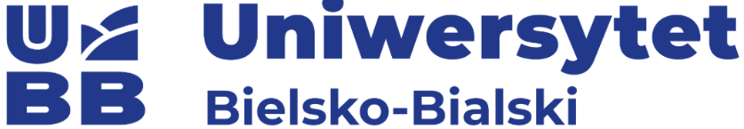

**Grafika i gry komputerowe**

**GDD**

# Wprowadzenie do pomysłu

Symulator śmieciarza (n.d.z) jest symulatorem, w którym można wcielić się w postać właściciela wysypiska śmieci. Gracz będzie miał za zadanie zarządzać wspomnianym biznesem, zbierać odpady, sprzedawać wartościowe śmieci dzięki zleceniom od klientów lub sprzedaży hurtowej. Dodatkowo gracz będzie miał możliwość poszerzenia swojego interesu poprzez kupowanie potrzebnych maszyn, zatrudnianie pracowników oraz rozwijanie umiejętności.
Gracz będzie musiał też pilnować zarządzania swoimi pieniędzmi, aby nie doszło w ostateczności do bankructwa.
Początkowe planowane jest zrobienie zawartości tak, aby gracz mógł spędzić maksymalnie 1 miesiąc (w grze), aby mógł się zapoznać z zawartymi mechanikami.

# Postacie – wprowadza avatarów i NPC, którzy będą obecni w grze

Gra wprowadza główną postać kontrolowaną przez gracza w widoku pierwszoosobowym oraz postacie NPC jako klientów oraz przechodniów.

# Projekt świata

Akcja gry będzie się odbywać w dwóch miejscach:
- Wysypisko śmieci, gdzie gracz będzie mógł nim zarządzać (budowanie/umieszczanie maszyn, zarządzanie pracownikami, itp)
- Miasto, gdzie gracz będzie mieć możliwość przechadzania się po nim, zbierać śmieci, realizować zlecenia i inne

# Fabuła

Gracz wciela się w rolę młodego biznesmena, który odziedziczył wysypisko śmieci w niewielkim mieście. To biznes rozwijany przez jego rodzinę od pokoleń. Jako osoba bez większego doświadczenia w tej branży, musi stawić czoła trudnemu zadaniu, ale także wyjątkowej szansie. Z jednej strony może doprowadzić wieloletni interes do bankructwa, z drugiej – stać się szanowanym milionerem znanym w całym regionie.

# Rozgrywka - ogólne założenia

Gracz będzie miał możliwość zarządzania swoją firmą jak również przechadzania się po różnych miastach mając na celu rozwijanie swojego biznesu. Złomowisko będzie zawierało szerokie możliwości pod względem budowy maszyn, poszerzenia terenu, zarządzaniem pracownikami i własnoręcznego oddzielania przedmiotów do odpowiednich materiałów. W mieście gracz będzie realizował zlecenia dostarczenia materiałów jak i przedmiotów, zbierał osobiście śmieci z różnych miejsc.
Oprócz finansów istotną mechaniką, która decyduje o tym, czy gracz może rozwijać swoją firmę w wybranym kierunku będzie system reputacji — od bardzo złej do bardzo dobrej. Zmienia się ona w zależności od percepcji staranności wykonywania usług w oczach mieszkańców jak, wpływu świadczonych usług na miasto (z perspektywy urzędników) oraz zasadności praktyk biznesowych.

# Mechaniki - ogólny opis

## Mechaniki dot. zarządzania (finanse, reputacja, itp.)

Podstawowymi wyznacznikami liczbowymi, czy gracz będzie mógł wykonać dana akcję w kontekście zarządzania przedsiębiorstwem są pieniądze (w wirtualnej walucie), poziom doświadczenia, punkty rozwoju oraz reputacja.

W ogólnym założeniu dane wskaźniki zmieniają się, gdy:
#### Pieniądze
Liczone w dolarach ($) — jako liczba całkowita. Natychmiastowo ich ubywa, gdy gracz dokonuje zakupu przedmiotów, zatrudnia pracowników, itp. Otrzymuje się je natychmiastowo po skończeniu zlecenia czy sprzedaży przedmiotu. Istnieją też opłaty powtarzające się — pensje pracowników (gdy gracz zatrudni kogoś oprócz siebie), opłata za budynek siedziby firmy (raczej już zsumowane czynsz, podatek od nieruchomości oraz opłaty za media). Nie ma możliwości zejścia poniżej 0 — zakupy są niemożliwe, lecz opłaty okresowe mogą doprowadzić do takiej sytuacji, lecz wtedy:
- Jeżeli to pierwsze zejście na minus funduszy — firma pożycza "osobiste środki szefa", np. 5000 waluty
- Jeżeli to kolejny raz albo fundusze nie wystarczyły — ekran przegrania gry; gracz wczytuje poprzedni zapis lub rozpoczyna nową grę
Opcjonalnie można wprowadzić system pożyczek — systematycznie odblokowywane przez proste obliczanie zdolności kredytowej (wartość firmy + poprzednie spłacone pożyczki). Każda pożyczka wprowadza comiesięczne opłaty celem jej spłacenia.

⚠️ TODO: Czy rozwój firmy powinien wpływać na opłaty regularne? Np. Czy nowe obiekty zwiększają rachunek za elektryczność? Wtedy rachunek za prąd powinien być jawnie osobny od innych opłat za budynek.

⚠️ TODO: Ogólna jej wartość — jaka jest minimalna/średnia pensja, ile kosztuje budynek, czynsz oraz przedmioty czy pojazdy?

⚠️ TODO: Jaki jest termin płatności? Czy jest to miesiąc jak zaproponowano dla ew. pożyczek czy też dzień lub tydzień?

#### Poziom doświadczenia
Nie można go stracić. Każdy kolejny poziom doświadczenia (LVL) zdobywa się po zdobyciu określonej liczby punktów doświadczenia (wyższa dla każdego kolejnego poziomu). Niektóre ulepszenia wymagają konkretnego LVL.

#### Punkty rozwoju
Zdobywane poprzez osiąganie kolejnych LVL postaci — np. LVL1 -> LVL2 daje 3 punkty rozwoju (SP). Wymagane zawsze do ulepszeń — reprezentują one pewnien poziom przestudiowanej wiedzy przez właściciela, np. aby zakupić maszynę X musi on mieć ulepszenie Y w drzewku rozwoju za 2 punkty rozwoju.

#### Reputacja
Reprezentowana liczbowo za pomocą zakresu od -100 do +100 z następującymi nazwami opisowymi:
- -100 — -75 — bardzo zła
- -75 — -25 — zła
- -25 — +25 — neutralna
- +25 — +75 - dobra
- +75 — +100 - bardzo dobra

⚠️ TODO: Oś liczbowa z zakresami

⚠️ TODO: Doprecyzować zakresy pod względem <> oraz () — łącznie/rozłącznie

⚠️ TODO: Czy zakres jest zbalansowany? Czy zakresy powinny być równe długością? 200 / 5 = 40. Obecnie "bardzo" ma długość 25, a pozostałe poziomy - 50.

Reputacja powinna być aktualizowana pod koniec każdego dnia — na podstawie ilości wykonanych zleceń (pozytywnie), tych wykonanych w czasie (pozytywnie), ze spóźnieniem (kara? mniej pozytywne?) oraz niewykonanych w ogóle mimo takiego obowiązku (negatywnie). Może być także aktualizowana okresowo — na przykład codziennie w czasie trwania wykupionej kampanii reklamowej.

⚠️ TODO: Czy kampania reklamowa powinna być zawsze neutralna/pozytywna dla reputacji jak to ma zazwyczaj miejsce w grach z taką mechaniką? Czy może powinnna być to szansa na dany efekt z wybranego zakresu? Firmie z gorszą reputacją trudniej ją poprawić reklamami, a takiej z neutralną reputacją wręcz bardzo łatwo.

⚠️ TODO: Czy kampania reklamowa może być negatywna (losowo) mimo dobrych przesłanek? Może to wprowadzić poziom trudności i losowości, który nie gwarantuje, że rzucenie pieniędzy na kampanię zawsze polepszy reputację.

## Mechaniki dot. rozgrywki (wyruszanie w/powrót z trasy, przemieszczanie się, itp.)

### Zlecenia od klientów
Klienci mogą zlecić graczowi zabranie od nich większej zawartości albo zakupić od firmy poszczególne przedmioty lub materiały. Po zaakceptowaniu danego zlecenia gracz będzie musiał dostarczyć zamówienie osobiście lub zlecić go komuś innemu.

### Zbieranie śmieci
Gracz będzie zbierał śmieci na różne sposoby (kosze na śmieci, zaśmiecone parki i ulice, zlecenia od mieszkańców, itp.) i je ładował do pojazdów. Dodatkowo gracz będzie mieć możliwość wybrania poszczególnych przedmiotów lub materiałów do wykorzystania na własny użytek (ulepszenie maszyn lub ewentualne dekorowanie swojego biura)

### Specjalne wydarzenia
Co jakiś czas będą odbywać się specjalne wydarzenia, które mogą pomóc lub przeszkadzać w trakcie rozgrywki np. nagły spadek ceny danego materiału, wszelakie święta, nadmierne opady deszczu, itp.

### Specjalne budynki
W mieście będą znajdować się różnorodne budynki oferujące aktywności dla gracza, który może wykorzystać do rozwijania interesu takie jak bank, lombard, sklep itp.

### Przemieszczanie się pomiędzy lokacjami
Gracz wykorzystując będzie się przemieszczał automatycznie pomiędzy złomowiskiem oraz miastem. Gracz będzie musiał brać pod uwagę czas jaki musi przeznaczyć, aby dotrzeć na miejsce.

### Poruszanie się po mieście
Gracz będzie mieć możliwość poruszania się po mieście za pomocą wybranego przez siebie pojazdu lub bez

### Obsługa maszyn
Gracz wykorzystując szeroki wybór maszyn będzie mógł przetwarzać zgromadzone materiały do utworzenia z nich poszczególnych dla danego materiału przedmiotu. Dodatkowo gracz będzie musiał obsługiwać maszyny zgodnie z instrukcją, w przeciwnym wypadku może to doprowadzić do ewentualnych awarii oraz utraty pieniędzy w celu naprawy.

# Sterowanie

Gracz **steruje swoją postacią** szefa bezpośrednio — porusza się w czterech kierunkach za pomocą przycisków WASD (lub lewą gałką kontrolera), a kamerą pierwszoosobową manipuluje za pomocą myszki (lub prawą gałką kontrolera).
Opcjonalnie może być dostępna akcja skoku (Spacja/A) na wypadek, gdyby graczowi udało się zaklinować pomiędzy obiektami.
Dodatkowym modyfikatorem ruchu będzie akcja sprintu (Shift - przytrzymanie/Naciśnięcie lewej gałki - toggle wł/wył).

| Akcja | K+M | Kontroler |
| ----- | --- | --------- |
| Ruch do przodu | W | ruch lewej gałki do przodu |
| Ruch w lewo | A | ruch lewej gałki w lewo |
| Ruch w prawo | D | ruch lewej gałki w prawo |
| Ruch do tyłu | S | ruch lewej gałki do tyłu |
| Sprint | Shift (przytrzymanie) | naciśnięcie lewej gałki (toggle wł/wył) |
| Skok | Spacja | A |

⚠️ TODO: Czy sprint powinien być ograniczony paskiem staminy?

**Sterowanie pojazdami** odbywa się identycznie poprzez klawisze WASD.
Na kontrolerze sterowanie pojazdami jest podzielone między spusty analogowe oraz lewą gałkę. Z racji, że zarówno spusty jak i gałka są analogowe, tzn. można je nacisnąć/przechylić z siłą od 0-100%, to, co jest typowe dla sterowania kontrolerem, siła nacisku wpływa na, to jak bardzo zmienia się wektor ruchu (na klawiaturze możliwie to zawsze będzie 100%).

| Akcja | K+M | Kontroler |
| ----- | --- | --------- |
| Pedał gazu / jazda do przodu | W | RT (prawy spust) |
| Skręt w lewo | A | ruch lewej gałki w lewo |
| Skręt w prawo | D | ruch lewej gałki w prawo |
| Hamulec / cofanie | S | LT (lewy spust) |

W konkteście **sterowania elementami interfejsu** (zarówno menu nieistniejącymi w świecie gry, takie jak menu główne i menu zapisu jak i panelami zarządzania biznesem z poziomu komputera w świecie gry), to odbywa się ono za pomocą myszki.
Jeżeli gracz gra na kontrolerze, to należałoby rodzielić sytuacje sterowania menu na zewnątrz i wewnątrz gry.
Poprzez menu główne, zapisu, itp. gracz poruszałby się za pomocą lewej gałki bądź krzyżaka (D-Pad) w celu wybrania opcji, zatwierdziałby ją przyciskiem A, a cofał/wychodził z menu przyciskiem B.
Menu wewnątrzgrowe — panele zarządzania, strony internetowe symulowałoby wirtualny kursor myszy.

| Akcja | K+M | Kontroler |
| ----- | --- | --------- |
| Wybór elementu menu głównego | myszka | ruch lewej gałki / krzyżak (D-Pad) |
| Ruch kursorem | myszka | ruch lewej gałki |
| Naciśnięcie przycisku | lewy przycisk myszy | A |
| Powrót do menu poprzedniego / wyjście z menu | prawy przycisk myszy / ESC | B |
| Przewijanie listy | rolka (scroll) | ruch prawej gałki |

# Sposób dystrybucji – w jakich kanałach prowadzona będzie sprzedaż/ promocja

- Twitter/X – promocja gry, zwiastuny, stworzenie społeczności

- Steam – promocja gry, zwiastuny

- YouTube – promocja gry, zwiastuny

- Strona internetowa – promocja gry, zwiastuny

# Model finansowania – w jakim wymiarze rozwiązanie będzie finansowane.

Źródła pozyskania środków:

- Sponsorzy

- YouTube

- Dofinansowania

# Wykonane przez:

Artur Piwowarczyk

Dawid Pawlica

Łukasz Skrzypek
